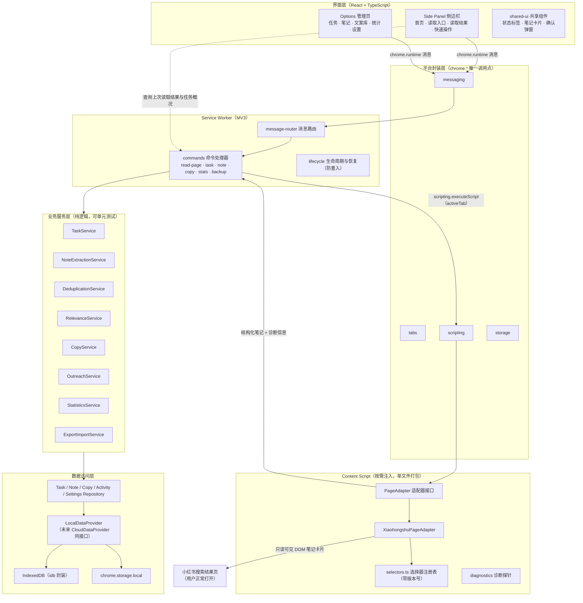

# 02 · 技术架构

## 1. 架构图



## 2. 分层与依赖规则

| 层 | 职责 | 依赖规则 |
|---|---|---|
| `ui` | 渲染与交互 | 只能调 `platform/messaging` 发消息；不直接碰 chrome.storage / IndexedDB |
| `background` | 消息路由、命令编排、生命周期 | 调 services + platform |
| `content` | 页面识别与提取（独立单文件 bundle） | 无运行时 import；输出纯数据结构 |
| `services` | 业务流程编排 | 调 `shared/domain` + `data` |
| `data` | 存储封装（Repository / DataProvider） | 调 `platform/storage` 与 IndexedDB |
| `platform` | chrome.* 薄封装 | **全项目唯一允许直接调用 chrome API 的层** |
| `shared` | 类型、常量、纯领域逻辑 | **零依赖**：不依赖 chrome、不依赖 React |

关键原则：`shared/domain` 里的去重、评分、状态机、统计、导入校验全部是纯函数，可在 Node 环境直接跑 Vitest，不需要真实小红书页面。

## 3. UI 形态决策（✅ 已确认：方案 C）

| 方案 | 优点 | 缺点 |
|---|---|---|
| A. Popup 弹窗 | 最简单 | 失焦即销毁；无法边浏览边读取；7 个页面塞不下 |
| B. Side Panel 侧边栏 | 浏览时保持打开；支持"浏览→读取→看结果"闭环；点击图标即打开 | 宽度有限（约 360–800px），长列表体验一般；需 Chrome 114+ |
| **C. Side Panel + Options 管理页（推荐）** | 侧边栏负责首页/读取/快速操作；管理页负责任务/笔记/文案/统计/设置的完整表格操作 | 两处 UI 需共享组件与消息契约 |

推荐 C：侧边栏 `default_path: sidepanel.html`，Service Worker 中 `chrome.sidePanel.setPanelBehavior({ openPanelOnActionClick: true })` 使点击图标打开侧边栏；管理页经 `options_page` 入口（chrome://extensions → 扩展程序选项）打开，也可在侧边栏内提供"打开管理页"按钮。

> ✅ **决策已确认**（用户确认）：采用方案 C —— Side Panel 侧边栏 + Options 管理页。侧边栏负责首页/读取/快速操作；管理页负责任务/笔记/文案/统计/设置的完整表格操作。

## 4. 依赖选型

| 依赖 | 用途 | 理由 / 备选 |
|---|---|---|
| react / react-dom | UI | PRD 指定 |
| typescript | 类型安全 | PRD 指定 |
| vite + @vitejs/plugin-react | 构建 | PRD 指定 |
| ~~@crxjs/vite-plugin~~ | — | **未采用（阶段 2 定稿，ADR-001）**：改用手工多入口 Vite 配置。理由：产物路径确定、manifest 手写可审查、不受插件与 Vite 版本兼容窗口影响。 |
| idb | IndexedDB 的 Promise 封装（Jake Archibald 出品，极小且稳定） | 备选：手写封装（约 100 行，可接受） |
| vitest + jsdom | 单元/集成测试；jsdom 用于解析模拟 HTML 测试提取器 | PRD 指定 Vitest；提取器函数设计为接收 `Document` 参数，天然可测 |
| fake-indexeddb | 在 Node 中测试 Repository 集成逻辑 | 仅 devDependency |
| @testing-library/react | UI 组件测试 | 可选 |
| playwright | E2E 与模拟页面测试 | 可选，阶段 6 评估后引入 |

不引入任何网络/云端依赖。**全部数据本地处理。**

**ADR-001 构建方案（阶段 2 定稿）**：不采用 `@crxjs/vite-plugin`，改用手工多入口 Vite 配置。

- 主构建 `vite.config.ts`：`input` = `sidepanel.html` / `options.html` / `src/background/index.ts`；`output.entryFileNames` 把 background 段固定输出为 `background.js`（manifest 直接引用），其余输出到 `assets/[name]-[hash].js`；`emptyOutDir: true`。
- 内容脚本 `vite.content.config.ts`：`lib` 模式 + `formats: ['iife']`，产出单文件 `content.js`（内容脚本不支持 ES module，且必须无拆分 chunk）；`emptyOutDir: false`。
- 构建顺序固定：主构建 → 内容脚本构建（顺序反了会被 `emptyOutDir` 清掉 content.js）。
- `sidepanel.html` / `options.html` 放在**项目根目录**：Vite MPA 按入口相对 root 的路径输出，若放在 `src/ui/*/` 会产出 `dist/src/ui/...`，与 manifest 中的平铺路径不符。
- 权衡：放弃插件提供的 HMR 与自动 manifest，换取确定产物路径、可审查的权限声明；开发期用 `scripts/watch.mjs` 同时 watch 两个配置，改完手动刷新扩展。

环境要求：Node ≥ 18，Chrome ≥ 114（Side Panel），其他 Chromium 系浏览器不承诺支持。

## 5. 目录结构

```text
canton-fair-assistant/
├── README.md
├── docs/                          # 阶段文档（本目录）
│   ├── 01-需求复核与风险分析.md
│   ├── 02-技术架构.md
│   ├── 03-数据模型.md
│   ├── 04-页面读取验证方案.md
│   └── 05-阶段1任务与验收清单.md
├── package.json
├── tsconfig.json
├── vite.config.ts                 # 主构建：sidepanel.html / options.html / background
├── vite.content.config.ts         # 内容脚本单文件 IIFE 构建
├── vitest.config.ts
├── sidepanel.html                 # 侧边栏入口（根目录，产物 dist/sidepanel.html）
├── options.html                   # 管理页入口（根目录，产物 dist/options.html）
├── public/
│   ├── manifest.json              # 手写（不采用 CRXJS 生成）
│   └── icons/ icon16.png icon48.png icon128.png
├── src/
│   ├── shared/                    # 纯 TS：零 chrome、零 React
│   │   ├── types/                 # task.ts note.ts copy.ts activity.ts settings.ts
│   │   │                           #   extraction.ts export.ts errors.ts
│   │   ├── constants/             # categories.ts keyword-presets.ts statuses.ts
│   │   │                           #   error-codes.ts scoring.ts
│   │   ├── domain/                # deduplication.ts relevance.ts status-machine.ts
│   │   │                           #   statistics.ts normalization.ts validation.ts
│   │   └── utils/                 # ids.ts time.ts result.ts text.ts
│   ├── services/                  # 业务服务层
│   │   ├── task-service.ts note-extraction-service.ts outreach-service.ts
│   │   ├── copy-service.ts statistics-service.ts export-import-service.ts
│   │   └── index.ts
│   ├── data/                      # 数据访问层
│   │   ├── db.ts migrations.ts repository.ts
│   │   ├── task-repository.ts note-repository.ts copy-repository.ts
│   │   ├── activity-repository.ts settings-repository.ts
│   │   └── index.ts
│   ├── platform/                  # chrome.* 薄封装（UI/服务侧唯一调用点；SW 自身注册监听器除外）
│   │   ├── messaging.ts tabs.ts scripting.ts storage.ts side-panel.ts
│   │   └── index.ts
│   ├── background/                # Service Worker
│   │   ├── index.ts message-router.ts lifecycle.ts
│   │   └── commands/              # read-page.ts task-commands.ts note-commands.ts
│   │                               #   copy-commands.ts stats-commands.ts backup-commands.ts
│   ├── content/                   # 按需注入提取脚本（单文件打包，无运行时 import）
│   │   ├── index.ts
│   │   ├── adapters/              # page-adapter.ts（接口）xiaohongshu-adapter.ts selectors.ts
│   │   ├── extractors/            # title.ts link.ts time.ts snippet.ts author.ts
│   │   ├── normalization.ts diagnostics.ts
│   ├── messaging/                 # 消息契约
│   │   └── messages.ts            # 类型安全的消息名与请求/响应类型映射
│   └── ui/
│       ├── shared/                # components/（StatusTag NoteCard ConfirmDialog…）
│       │                           #   hooks/（useAsyncState useMessages）
│       ├── sidepanel/             # main.tsx App.tsx pages/（home.tsx read-result.tsx）
│       └── options/               # main.tsx App.tsx nav.ts
│           └── pages/             # dashboard.tsx tasks.tsx task-form.tsx notes/（list.tsx detail.tsx）
│                                   #   copy.tsx stats.tsx settings.tsx
├── tests/
│   ├── unit/                      # deduplication.test.ts relevance.test.ts normalization.test.ts
│   │                               #   status-machine.test.ts statistics.test.ts validation.test.ts …
│   ├── integration/               # repositories.test.ts（fake-indexeddb）
│   │                               #   export-import.test.ts services.test.ts
│   └── fixtures/
│       ├── pages/                 # search-normal.html search-empty.html missing-title.html
│       │                           #   missing-link.html missing-time.html duplicate-notes.html
│       │                           #   changed-structure.html not-ready.html login-wall.html non-xhs.html
│       └── datasets/              # export-v1-valid.json export-v1-invalid.json …
└── scripts/
    └── make-icons.ps1             # 生成占位图标（阶段 2）
```

## 6. Manifest V3 初步权限配置

```json
{
  "manifest_version": 3,
  "name": "广交会推广助手",
  "version": "0.1.0",
  "permissions": ["storage", "activeTab", "scripting", "sidePanel"],
  "host_permissions": ["*://*.xiaohongshu.com/*"],
  "background": { "service_worker": "background.js", "type": "module" },
  "side_panel": { "default_path": "sidepanel.html" },
  "options_page": "options.html",
  "action": { "default_title": "打开广交会推广助手" },
  "icons": { "16": "icons/icon16.png", "48": "icons/icon48.png", "128": "icons/icon128.png" }
}
```

| 权限 | 必要性 | 说明 |
|---|---|---|
| `storage` | 必要 | 保存轻量设置（`chrome.storage.local`）。**不使用 `storage.sync`**，避免设置同步到谷歌服务器。 |
| `activeTab` | 必要 | 用户点击扩展图标时，仅对当前标签页临时授权；标签页关闭或跨源导航即失效。替代任何站点权限的起步方案。 |
| `scripting` | 必要 | 配合 activeTab 按需注入提取脚本（`chrome.scripting.executeScript`），不常驻页面。 |
| `sidePanel` | 必要 | 侧边栏界面（Chrome 114+）。 |
| `host_permissions` | **必要（阶段 2 验收后改判）** | **仅限 `*://*.xiaohongshu.com/*`**。阶段 2 实测发现：`activeTab` 在「点图标打开侧边栏」这条路径上拿不到授权（见下方说明），交付版读取功能在真实页面不可用，因此改为显式站点权限。 |

> **阶段 2 验收结论（2026-10-18，Chrome 150.0.7871.125）**：原先「不声明 host_permissions、只靠 activeTab」的方案被实测证伪。
> 用户点击工具栏图标（`openPanelOnActionClick: true` 会直接打开侧边栏）之后，从扩展上下文读到的状态是
> `chrome.permissions.getAll()` → `{ origins: [], permissions: ["activeTab","storage","scripting","sidePanel"] }`，
> `chrome.tabs.query({active:true,currentWindow:true})` 返回的标签**没有 `url`/`title`**，
> `chrome.scripting.executeScript` 报 `Cannot access contents of the page. Extension manifest must request permission…`；
> 侧边栏保持打开、当前标签始终为小红书的情况下连续轮询 4 分钟，从未出现可读 `tab.url` 的时刻。
> 同一份代码仅加上 `host_permissions: ["*://*.xiaohongshu.com/*"]` 后，真实页面探针 11 步全部读取成功。
> 影响：`docs/04` 的 D2 第 8 步（"未授权应报权限不足"）在站点权限下不再成立，需同步修订。

**明确不申请**：`tabs`（activeTab 已覆盖当前页 url）、`downloads`（导出用页面内 Blob 下载实现）、`cookies`、`webRequest`、`history`、`unlimitedStorage`、`<all_urls>`。

## 7. 消息协议（概要）

所有消息经 `chrome.runtime.sendMessage`，请求/响应类型集中定义在 `messaging/messages.ts`；响应统一为 `Result<T, AppError>`。

| 消息名 | 方向 | 说明 |
|---|---|---|
| `read-page` | UI → SW | 读取当前活动标签页的可见笔记（需先选择当前任务） |
| `get-dashboard` | UI → SW | 首页概况（当前任务、待审核/待处理数、上次读取结果） |
| `task.*` | UI → SW | 任务 CRUD、启停、选择当前任务 |
| `note.*` | UI → SW | 笔记列表查询、详情、状态标记、备注 |
| `copy.*` | UI → SW | 文案 CRUD、设默认、复制 |
| `stats.overview` | UI → SW | 统计面板数据 |
| `backup.export / backup.import` | UI → SW | 数据备份 |

注意：`read-page` 是 fire-and-forget 语义——读取结果**落库**后由 UI 查询展示，不依赖消息回调存活（popup/侧边栏可能重载）。

响应信封统一为**单层**：服务层返回 `Result`，命令层 `unwrap()` 后返回纯值（失败抛 `AppError`），路由器包一层 `{ok:true,value}` / `{ok:false,error}`。

内容脚本与 background 的数据回传采用**两段式注入**：IIFE 打包的 content.js 脚本完成值为空，故由内容脚本把结果写到 isolated world 全局键（`__CANTON_FAIR_LAST_DIAGNOSTICS__`），background 再用 `executeScript({func})` 读回。
