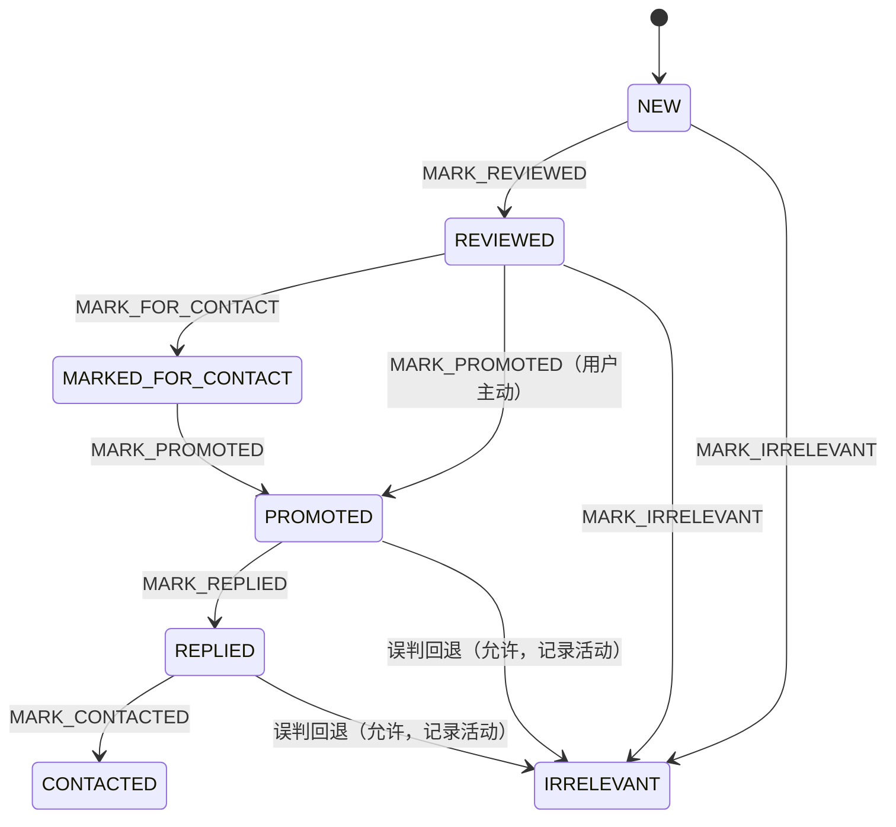

# 03 · 数据模型

## 1. 存储选型

| 维度 | chrome.storage.local | IndexedDB |
|---|---|---|
| 配额 | 10 MB | 磁盘百分比，第一版量级无压力 |
| 结构 | 键值对 | 对象仓库 + 索引 + 事务 |
| 写频率限制 | 有（每项每分钟约 120 次写入，批量超限会失败） | 无实用限制 |
| 适合 | 设置、偏好（几 KB） | 任务/笔记/活动等批量业务数据 |

**结论**：设置 → `chrome.storage.local`；任务、笔记、文案、活动 → IndexedDB。二者统一封装在 Repository 之后，业务层不感知差异；`LocalDataProvider` 实现统一数据访问接口，未来 `CloudDataProvider` 实现同一接口即可扩展云同步（第一版不实现）。

## 2. 基础类型与错误模型

```ts
// shared/types/base.ts
export type ID = string;            // crypto.randomUUID()
export type ISODate = string;       // ISO 8601
export type Result<T, E = AppError> =
  | { ok: true; value: T }
  | { ok: false; error: E };

export interface AppError {
  code: ErrorCode;       // 机器可读错误码
  message: string;       // 面向普通用户的文案
  detail?: string;       // 开发调试信息
  cause?: unknown;
}

export enum ErrorCode {
  UNSUPPORTED_PAGE = "UNSUPPORTED_PAGE",
  PERMISSION_DENIED = "PERMISSION_DENIED",
  PAGE_NOT_READY = "PAGE_NOT_READY",
  NO_VISIBLE_NOTES = "NO_VISIBLE_NOTES",
  DOM_STRUCTURE_CHANGED = "DOM_STRUCTURE_CHANGED",
  EXTRACTION_PARTIAL = "EXTRACTION_PARTIAL",
  LOGIN_REQUIRED = "LOGIN_REQUIRED",                  // 新增：疑似登录墙
  CAPTCHA_OR_RISK_CONTROL = "CAPTCHA_OR_RISK_CONTROL",// 新增：验证码/风控
  STORAGE_ERROR = "STORAGE_ERROR",
  IMPORT_INVALID = "IMPORT_INVALID",
  INVALID_INPUT = "INVALID_INPUT",                    // 新增：任务/设置等输入校验失败
  UNKNOWN_ERROR = "UNKNOWN_ERROR",
}
```

所有服务与 Repository 方法返回 `Result`；UI 对失败状态必须展示，绝不静默。

## 3. Task 任务模型

```ts
// shared/types/task.ts
export enum TaskCategory {
  CANTON_FAIR = "CANTON_FAIR",             // 广交会相关讨论
  FOREIGN_BUYER = "FOREIGN_BUYER",         // 外商采购和商务交流
  INTERPRETER = "INTERPRETER",             // 英语翻译需求
  EXHIBITION_COMPANION = "EXHIBITION_COMPANION", // 展会陪同需求
  BUSINESS_RECEPTION = "BUSINESS_RECEPTION",     // 商务接待与沟通
  OTHER = "OTHER",                         // 自定义场景
}
export type TaskLanguage = "zh" | "en" | "mixed";
export type TaskStatus = "ACTIVE" | "PAUSED" | "ARCHIVED";

export interface DateRange { from: ISODate | null; to: ISODate | null; }

export interface RelevanceConfig {
  titleWeight: number;         // 默认 3（标题命中权重）
  snippetWeight: number;       // 默认 1（摘要命中权重）
  categoryBonus: number;       // 默认 10（场景关键词组命中加分）
  timeInRangeBonus: number;    // 默认 5（发布时间在目标区间内）
  timeOutOfRangePenalty: number; // 默认 -10
  negativeKeywordPenalty: number; // 默认 -15（每条负向关键词）
  negativeKeywords: string[];  // 默认空，用户可配置
  highThreshold: number;       // 默认 50（换算后 0-100 分制）
  mediumThreshold: number;     // 默认 27
}

export interface Task {
  id: ID;
  name: string;
  keywords: string[];
  language: TaskLanguage;
  category: TaskCategory;
  dateRange: DateRange;
  relevanceConfig: RelevanceConfig;
  copyIds: ID[];               // 关联宣传文案
  status: TaskStatus;
  notes: string;               // 用户备注
  createdAt: ISODate;
  updatedAt: ISODate;
}
```

## 4. Note 笔记模型

```ts
// shared/types/note.ts
export enum NoteStatus {
  NEW = "NEW",                                   // 新发现（默认）
  REVIEWED = "REVIEWED",                         // 已审核
  MARKED_FOR_CONTACT = "MARKED_FOR_CONTACT",     // 待联系
  PROMOTED = "PROMOTED",                         // 已完成推广（用户主动标记）
  REPLIED = "REPLIED",                           // 已收到回复
  CONTACTED = "CONTACTED",                       // 已建立联系
  IRRELEVANT = "IRRELEVANT",                     // 不相关
}
export type RelevanceLevel = "high" | "medium" | "low";

export interface RelevanceReason {
  rule: string;          // 规则名，如 "title-keyword" "category-match" "time-in-range"
  description: string;   // 面向用户解释，如 标题包含 “Canton Fair”
  scoreDelta: number;    // 该规则贡献的原始分
}

export interface RelevanceResult {
  taskId: ID;                    // 该评分相对哪个任务
  score: number;                 // 0–100
  level: RelevanceLevel;
  matchedKeywords: string[];
  reasons: RelevanceReason[];
  evaluatedAt: ISODate;
}

export interface Note {
  id: ID;
  canonicalUrl: string;          // https://www.xiaohongshu.com/explore/{noteId}
  dedupeKey: string;             // "url:{noteId}" 或 "fp:{fingerprint}"
  dedupeKeyType: "url" | "fingerprint";
  title: string;
  contentSnippet: string | null;
  publishedAt: ISODate | null;   // 无法确定时为 null，UI 显示“时间未知”
  publishedAtRaw: string | null; // 页面原文（如“3 天前”），保留透明性
  authorDisplayName: string | null;
  relevance: RelevanceResult;              // 最近一次评估（列表展示用）
  relevanceByTask: Record<ID, RelevanceResult>; // 各任务视角的评分
  sourcePageUrl: string;         // 来源页面（仅 origin + pathname，不含查询参数）
  extractedAt: ISODate;
  extractionVersion: string;     // 提取器/选择器版本，便于回溯
  extractionQuality: "complete" | "partial";
  taskIds: ID[];                 // 关联任务（一条笔记可属多个任务）
  status: NoteStatus;
  userNotes: string;
  createdAt: ISODate;
  updatedAt: ISODate;
}
```

约束：`authorDisplayName` 只是页面可见显示名；**不得**把推测的用户身份、联系方式或需求伪装成事实字段。

### 状态机



- 非法转移被拒绝并提示（例如 NEW 直接 → REPLIED）。
- `OPEN_NOTE`、`COPY_TEXT` **不是**状态转移，绝不影响 `NoteStatus`；`MARK_PROMOTED` 只能由用户显式点击触发。
- 每次状态变更写入一条 `OutreachActivity`。

## 5. PromotionalCopy 宣传文案模型

```ts
// shared/types/copy.ts
export type CopyLanguage = "zh" | "en" | "bilingual";

export interface PromotionalCopy {
  id: ID;
  name: string;
  content: string;
  language: CopyLanguage;
  scenario: TaskCategory | "GENERAL";
  tags: string[];
  isDefault: boolean;       // 全局唯一默认文案
  createdAt: ISODate;
  updatedAt: ISODate;
}
```

第一版不做版本控制系统；复制文案仅写入剪贴板，**不**提交到任何页面。

## 6. OutreachActivity 推广活动模型

```ts
// shared/types/activity.ts
export enum ActivityAction {
  OPEN_NOTE = "OPEN_NOTE",
  COPY_TEXT = "COPY_TEXT",
  MARK_REVIEWED = "MARK_REVIEWED",
  MARK_FOR_CONTACT = "MARK_FOR_CONTACT",
  MARK_PROMOTED = "MARK_PROMOTED",
  MARK_REPLIED = "MARK_REPLIED",
  MARK_CONTACTED = "MARK_CONTACTED",
  MARK_IRRELEVANT = "MARK_IRRELEVANT",
  ADD_NOTE = "ADD_NOTE",          // 手动添加
  EDIT_NOTE = "EDIT_NOTE",
  TASK_CREATED = "TASK_CREATED",
  TASK_UPDATED = "TASK_UPDATED",
  TASK_DELETED = "TASK_DELETED",
}

export interface OutreachActivity {
  id: ID;
  noteId: ID | null;
  taskId: ID | null;
  action: ActivityAction;
  actionAt: ISODate;
  copyId?: ID;
  result?: string;         // 结果记录（自由文本）
  userComment?: string;
}
```

语义区分（统计口径必须一致）：`OPEN_NOTE` ≠ 已推广；`COPY_TEXT` ≠ 已发布；`MARK_PROMOTED / REPLIED / CONTACTED` 只能由用户显式操作产生。

## 7. Settings 设置模型

```ts
// shared/types/settings.ts
export interface Settings {
  defaultTaskId: ID | null;
  defaultCopyId: ID | null;
  defaultRelevanceConfig: RelevanceConfig;
  uiPrefs: {
    theme: "light" | "dark" | "system";
    collapsedLowRelevance: boolean;   // 低相关默认折叠
    pageSize: number;
  };
  backup: { lastExportAt: ISODate | null; exportReminder: boolean };
  privacy: { keepDiagnostics: boolean };  // 诊断仅存本地，永不上传
}
```

**不保存**：平台密码、Cookie、会话凭证（任何形式）。

## 8. 读取结果与诊断模型

```ts
// shared/types/extraction.ts
export type PageType = "search_results" | "note_detail" | "profile" | "other";

export interface NoteDraft {            // 页面原始提取，规范化前
  url: string | null;
  title: string | null;
  snippet: string | null;
  publishedAtRaw: string | null;
  authorDisplayName: string | null;
  quality: "complete" | "partial";
  missingFields: Array<"url" | "title" | "snippet" | "publishedAt">;
}

export interface ExtractionDiagnostics {
  startedAt: ISODate;
  finishedAt: ISODate;
  durationMs: number;
  pageType: PageType | null;
  pageUrl: string;                       // origin + pathname，不含查询参数（隐私）
  isSupported: boolean;
  selectorVersion: string;
  totalCandidates: number;               // 识别的候选卡片数
  extracted: number;                     // 提取成功数
  partial: number;                       // 部分字段缺失数
  skipped: number;
  skipReasons: Record<string, number>;   // 如 { "missing-link": 12 }
  signals: {
    noteSections: number;                // section.note-item 数量
    exploreLinks: number;                // /explore/ 链接数量
    resultContainers: number;
    appShellRendered: boolean;
    loginWallDetected: boolean;
    captchaDetected: boolean;
  };
  errors: Array<{ code: ErrorCode; message: string; detail?: string }>;
}

export interface ReadPageResult {
  diagnostics: ExtractionDiagnostics;
  processed: { total: number; added: number; duplicates: number; failed: number; failureReasons: string[] };
}
```

## 9. 导出/导入模型

```ts
// shared/types/export.ts
export interface ExportBundle {
  format: "canton-fair-assistant-backup";
  schemaVersion: number;     // 1
  exportedAt: ISODate;
  appVersion: string;
  data: {
    tasks: Task[];
    notes: Note[];
    copies: PromotionalCopy[];
    activities: OutreachActivity[];
    settings: Settings | null;
  };
}
```

## 10. 去重规则

1. 从笔记链接提取笔记 ID：路径匹配 `/(?:explore|discovery\/item)\/([a-f0-9]{24})/`（小红书笔记 ID 为 24 位 hex），规范化为 `https://www.xiaohongshu.com/explore/{id}`，丢弃全部查询参数（`xsec_token` 等）。
2. 有 ID → `dedupeKey = "url:{id}"`，全局唯一。
3. 无稳定链接 → 指纹 `fp:{hash(规范化标题 | 作者显示名)}`；**标题规范化后完全一致 + 作者一致**才视为同一候选，标题相似不算同一条。
4. 同一笔记被不同任务发现：保留一条全局记录，`taskIds` 追加关联，`relevanceByTask` 记录各任务评分。

## 11. 数据一致性策略

| 场景 | 策略 |
|---|---|
| 重复导入 | 按 `id` 合并；字段冲突以 `updatedAt` 较新者为准；导入报告中列出冲突条数与合并结果。 |
| 同一笔记关联多任务 | 全局单条 Note + `taskIds` 数组 + `relevanceByTask`。 |
| 删除任务 | 不删除笔记；从笔记 `taskIds` 移除该任务；失去全部关联的笔记显示"未关联任务"，设置页提供清理入口；活动记录保留。 |
| 笔记状态更新 | 全部经 OutreachService 校验状态机 + 写活动记录，非法转移拒绝。 |
| 数据格式升级 | IndexedDB 记录 `schemaVersion`，`migrations.ts` 顺序迁移；迁移失败则中止并保留原数据，报 `STORAGE_ERROR`。 |
| 导入文件结构错误 | 导入前逐字段校验（`shared/domain/validation.ts`）；任一顶层数据非法则整体拒绝并列出错误明细（事务语义）。 |
| 存储写入失败 | Repository 返回 `Result` 失败；UI 显示错误横幅，**绝不显示成功**。 |
| 误删数据恢复 | 删除任务前强制确认并提示先导出备份；导出 JSON 是恢复主渠道。第一版不实现回收站（记录为已知限制）。 |
